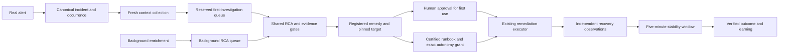
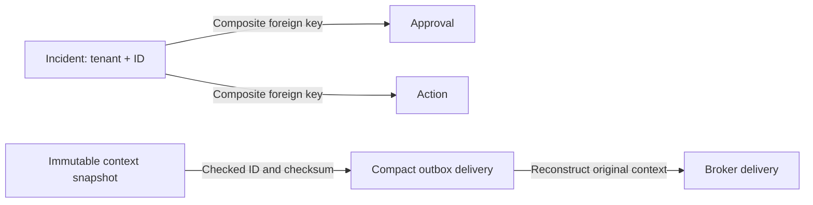

# KaiMS Autonomous Operations Evolution Plan

## 1. Repository assessment

KaiMS already has an event-driven microservice core, typed shared events, tenant isolation,
an investigation loop, governed execution plans, approval/remediation services, telemetry-based
closure validation, cloud-operation connectors, a React incident cockpit, and evaluation tests.
The safest path is incremental contract hardening and capability completion, not a rewrite.

## 2. Existing module map

| Domain | Current modules | Decision |
| --- | --- | --- |
| Ingestion and correlation | `monitoring-adapter`, `alert-intelligence`, RabbitMQ/Kafka adapters | KEEP / REFINE |
| Context and discovery | `context-agent`, `discovery-mcp` | KEEP / REFINE |
| Investigation and RCA | `resolution-agent/{graph,investigation,evidence,confidence}.py` | REFINE |
| Planning and policy | `common/orchestration`, approval service | KEEP / REFINE |
| Execution | remediation engine and connector plugins | KEEP / REFINE |
| Outcome validation | closure service validators and observations | KEEP / REFINE |
| Learning/evaluation | evaluation service, learning audit records | REFINE |
| Operator experience | React incident, approval, cloud-operation routes | REFINE |
| Legacy free-text projections | flat recommendation/command compatibility fields | DEPRECATE after typed consumers migrate |

## 3. Identified gaps

- Several Resolution Agent boundaries still use untyped dictionaries.
- Hypothesis states and non-conclusive outcomes are not canonical contracts.
- Runbook/change presence contributes to confidence without proving causality.
- Resolution options, impact, blast radius, learning, and AgentOps contracts are incomplete.
- Specialist routing, knowledge graph, source-code RCA, shadow promotion, and proactive operations
  need bounded implementations and persistence.
- UI capability exists but needs typed evidence factors, hypothesis tests, options, and live events.

## 4. Proposed target architecture

Preserve the current services. Introduce versioned contracts at their boundaries and evolve the
flow through normalize/correlate, context, bounded investigation, evidence judge, typed RCA,
ranked resolution options, governed execution plan, policy/approval, connector execution,
independent validation, rollback, and learning. Compatibility projections remain until every
consumer accepts the new contracts.

## 5. Files/modules to change

- Resolution graph, investigator, evidence compiler, confidence engine, and API.
- Shared orchestration contracts and repositories.
- Remediation policy/plugins and closure validation.
- Incident cockpit, evidence explorer, approval workflow, and onboarding routes.
- Focused backend, UI, security, integration, and evaluation tests.

## 6. New files/modules to create

- Versioned resolution intelligence contracts and specialist registry.
- Impact/blast-radius and resolution-option services.
- Skill, credential-broker, validation, rollback, memory, AgentOps, and evaluation contracts.
- Phase-specific migrations and evaluation fixtures.

## 7. Data model changes

Extend the existing investigation tables rather than replacing them. Persist canonical plans,
hypotheses, evidence relationships, resolution options, impact/blast radius, validation and
rollback outcomes, operator corrections, learning records, and agent execution traces with tenant,
incident, correlation, causation, schema-version, and idempotency fields.

## 8. API/event contract changes

Add versioned contracts while retaining current endpoints. Every new event includes tenant,
incident, correlation and causation identity. Non-conclusive RCA uses explicit outcomes such as
`INSUFFICIENT_EVIDENCE`, `CONFLICTING_EVIDENCE`, and `CONNECTOR_FAILURE`; it never carries an
asserted root cause.

## 9. Database migrations

Use additive, backward-compatible migrations. Backfill only deterministic values, keep old
columns during consumer migration, and add tenant-scoped indexes and immutable audit records.

## 10. UI changes

Incrementally extend the incident cockpit with investigation questions, hypotheses, supporting and
contradicting evidence, confidence factors/penalties, ranked resolution options, blast radius,
autonomy decision, execution progress, validation, rollback, and audit views.

## 11. Security implications

Authenticated tenant identity remains authoritative. Investigation tools are read-only and
allow-listed. Production mutations require registered skills, resource-scoped credential
references, policy, preflight, validation, audit, and approval where required. Model text never
becomes a command.

## 12. Test strategy

Each phase adds unit, contract, integration, security/failure, evaluation, and UI coverage. P0
tests prove weak/conflicting evidence cannot produce a root cause, tool failures are explicit,
confidence ignores severity, and investigation budgets stop safely.

## 13. Phased implementation plan

1. Resolution intelligence: typed investigation/hypothesis/RCA/evidence/options and calibrated confidence.
2. Safe remediation: capability registry, blast radius, credential broker, preflight/dry-run.
3. Outcome validation: domain validators, observation windows, rollback, false-closure prevention.
4. UX: onboarding/connections, command center, evidence explorer, options and HITL edits.
5. Learning/AgentOps: incident memory, evaluation data, calibration, shadow/autonomy progression.
6. Differentiators: source-code RCA, knowledge graph, evidence council, preventive operations.

Each phase is independently deployable and retains compatibility adapters until its consumers have
migrated.

## 14. Telemetry outage architecture review — 18 October 2026

The first real frontend-proxy stop was detected, but its context waited behind
background enrichment. No RCA or corrective action completed during the test.
Recovery was manual; that run is not evidence of self-healing.

The corrective design preserves the existing services and contracts:

- Both queues share the existing maximum of 50 concurrent analysis jobs. The
  reserved queue prevents initial investigations from waiting behind enrichment.
- Expired initial evidence is recollected through the context service. The old
  snapshot remains immutable; its expiry is never extended to make it pass.
- Correlation can recover a stalled first investigation or a new firing cycle
  without creating another incident. A durable, bounded outbox identity prevents
  repeated source deliveries from generating unlimited retries.
- Discovery preserves tenant, environment, job, and instance scope. Registered
  probe jobs use their actual monitoring source rather than assuming that an
  application's OTLP Prometheus also owns its external probes.
- A stopped-workload hypothesis requires the exact workload's recorded exit and
  an independent failed HTTP probe after that exit. It does not establish why
  the process exited, OOM, customer counts, or business losses without evidence.
- External Compose recovery requires an operator-owned tenant/environment/service
  binding, exact Compose labels, pinned container ID, and a configured health URL.
  Recreating the target requires updating that binding.
- A configured reviewed catalog option may prepare a first-use plan for HITL.
  Configuration does not certify a runbook or authorize unattended execution.
- Selection preserves the persisted alert identity and rejects service or
  environment changes. A display title cannot change the validation profile.
- The telemetry recovery profile registers six real checks: HTTP availability,
  alert clearance, probe failure fraction, probe latency, the product-catalog read
  path, and scoped critical alerts. Every check retains source provenance and a
  300-second post-execution observation window. Customer error rate remains
  unquantified by these synthetic probes.

Evidence and live retest results are recorded under
`artifacts/telemetry-recovery-e2e/`. A healthy manually started service, a compiled
plan, passing unit tests, or a cleared alert alone must never be reported as an
automatic recovery success.

### Additional defects reproduced during live execution

The review followed the actual stopped container through each handoff. It found
several independent failures rather than a single model-quality problem:

| Boundary | Reproduced defect | Correction |
| --- | --- | --- |
| Alert delivery | Recovery followed by another outage reused the same fingerprint and cooldown | Deduplicate deliveries by fingerprint, state, and normalized episode onset; retain the canonical incident |
| Initial analysis | Fresh incidents waited behind background RCA deliveries | Reserved initial-investigation lane under the same shared 50-job budget |
| Discovery | External probes were queried from the application's metrics server | Resolve the monitoring source from the registered probe job and preserve exact job/instance scope |
| Historical queries | Prometheus evaluated future range steps using lookback values | Cap query end at the current time; retain actual source samples |
| Causal synthesis | Generic synthesis discarded a tested stopped-workload mechanism | Deterministic bounded synthesis only after independent runtime-exit and post-exit probe evidence pass the existing investigator |
| Plan selection | A proposed executable plan was mistaken for a durably compiled selection | Always prepare the registered first-use remedy for approval unless a selection already exists |
| Plan retry | Recompilation reused a plan ID with a different timestamp/fingerprint | Reuse the original immutable persisted plan on redelivery |
| Approval display | Receipt display and approval submission loaded different plan versions | Both hydrate the current recommendation and canonical compiled plan from durable storage |
| Execution binding | Compiled plan ID and fingerprint were absent or inconsistent in the incident binding | Persist both together and repair them on idempotent compilation replay |
| Local authorization | Local approval accepted the default tenant while execution rejected it unconditionally | Permit the exact persisted default-tenant approval only in local auth mode; retain OIDC rejection |
| Runbook governance | The executor ignored the governance ID and checksum inside the approved plan | Read the immutable plan fields and verify the same approved database version, checksum, and expiry |
| Jenkins transport | Full execution plans were placed in the URL and rejected with HTTP 414 | POST form parameters in the request body |
| Jenkins contract | Pipeline expected an older preflight field and restart command shape | Support canonical preflight fields and exactly reconstructed pinned, stopped-container start commands; reject injected shell suffixes |
| Jenkins health check | The allowlist rejected a valid HTTP root path | Permit an empty path suffix after the required slash; validate all actual plan commands before deployment |
| Async lifecycle | Successful execution retained the ready-to-execute lifecycle | Advance dispatch and terminal receipt through execution and validation; independent closure still owns recovery |
| Retry reporting | Exhausted dispatch errors left an action appearing active | Persist a terminal failure on the last configured dispatch attempt; separately approved retries retain distinct workflow identities |

A pinned external recovery uses Docker's idempotent `start`, after selecting only
an exited/dead container with the exact ID and Compose labels. It cannot restart
a workload that has already recovered. The underlying reason for a process exit
remains a separate follow-up question; this diagnosis establishes the immediate
availability mechanism only.

Local intake scope and the operator-owned pinned target are retained in local
deployment settings and passed by the shared Compose environment. Container
recreation requires refreshing that pin. First-use execution remains supervised:
configuration, model confidence, a static catalog entry, and a single successful
test do not grant unattended autonomy.

The clean recurrence retest also reproduced an occurrence-key collision: the
canonical occurrence key used the Prometheus fingerprint without the source
onset. A new real firing cycle was therefore returned as an already-consumed
occurrence before the closed-generation check could run. Occurrence identity now
hashes tenant, source event identity, and normalized onset. Same-episode delivery
retries remain idempotent; a later episode can acquire a new correlation
generation after closure. The regression test uses the same fingerprint for both
episodes, matching Prometheus rather than inventing a new source identity.

The recurrence run exposed an additional generation-promotion race after physical
recovery: background enrichment generated a newer inconclusive report from the
now-healthy system and displaced the approved generation in the incident view.
The reviewed execution generation now owns the active binding through independent
recovery validation. Background candidates and evidence remain retained, but
candidate events cannot replace that binding. Enrichment RCA is coalesced while
a governed recovery owns the incident. Read models resolve the same typed,
plan-fingerprint-bound action instead of independently selecting the latest RCA.
An explicit pre-execution operator rerun remains distinct from background work.

The final fresh local outage test passed for incident
`656817b7-7932-4c0c-8218-30e50bfbf0d9`. Native alert delivery created the incident,
grounded RCA and technical impact completed, and KaiMS/Jenkins started the stopped
frontend proxy at 15:24:45 UTC after authenticated supervised approval and
execution confirmation. Six independent recovery checks recorded 66 observations
over 338.818 seconds before closing the incident. This run required no alert
redrive, manual analysis, manual catalog selection, manual service restart, or
executor reconciliation. The approved RCA generation remained bound through
closure. All 290 focused regression tests passed. This proves supervised recovery
for this local stopped-workload scenario; unattended self-healing remains unproven.
The final receipt is retained in
[native-final/result.json](../artifacts/telemetry-recovery-e2e/native-final/result.json).

## 15. End-to-end failure-path design review — 18 October 2026

The review followed source identity through durable intake, analysis admission,
context/RCA, immutable plan selection, approval, execution, independent validation,
and the incident read model. The existing boundaries remain useful; this pass
hardens asynchronous ownership rather than adding another orchestration layer.

```mermaid
flowchart LR
    A[Source alert and onset] --> B[Canonical incident and durable outbox]
    B --> C[Bounded initial investigation lane]
    C --> D[Evidence-bound RCA and technical impact]
    D --> E[Immutable scoped plan]
    E --> F[Approval and execution confirmation]
    F --> G[Temporal-owned executor action]
    G --> H[Independent stability observations]
    H --> I[Verified closure]
```

| Boundary reviewed | Required contract and validation |
| --- | --- |
| Alert to incident | Same-episode delivery is idempotent; later onset can create a new incident after closure. Persistence and admission regression tests cover recurrence. |
| Queue to investigation | Initial work has a separate lane under the shared capacity budget; expired, synthetic and terminal work is retired. Lane, backpressure and durable-outbox tests passed. |
| Evidence to RCA/impact | Stopped-workload diagnosis requires runtime evidence plus an independent failed probe. Customer impact remains unquantified without evidence. Collector and causal-gate tests passed. |
| Plan to execution | Immutable fingerprint, exact target, tenant scope and persisted approval remain mandatory. Approval, selection and executor-contract tests passed. |
| Execution to closure | Executor success does not close an incident by itself. Independent recovery and stability validation retain the approved analysis generation. Closure and generation-binding tests passed. |
| Backend to UI | Incident navigation, evidence presentation, approval receipts and resolution status use recorded state. Seven focused UI test files passed. |

This pass reproduced and fixed the following additional defects:

| Defect | Effect | Implemented correction |
| --- | --- | --- |
| Delayed execution timeout | A completed action could be overwritten as timed out | Preserve terminal receipts; verify the execution contract and perform one final read-only observation before declaring an unresolved action timed out. |
| Repeated terminal reconciliation | An already completed action was observed again unnecessarily | Reuse its persisted terminal result and finalize its durable handoff without polling the executor again. |
| Superseded approval callback | An old workflow could mutate the newer approved retry stored under the same plan key | Require matching approval ID, incident and tenant before execution/rollback observation, timeout or failure handling. |
| HTTP failure after executor acceptance | An accepted or completed execution could be relabeled failed | Retain terminal receipts; reconcile an accepted action instead of treating the HTTP error as executor-failure evidence. |
| Rollback deadline race | A completed rollback could become a manual-intervention timeout | Reconcile the existing rollback before escalation and retain its terminal result. |
| Poll-count deadline | Slow observation activities and retries extended the configured wait | New workflow runs count elapsed workflow time, including observation/retry time; an in-flight bounded observation can finish before the final deadline check. |
| Activity cancellation | A cancelled activity could leave its local HTTP child task running | Cancel and drain the child request. This does not claim to cancel an already accepted external operation; durable reconciliation remains necessary. |

Temporal patch markers preserve the original command path when replaying older
histories. Regression tests exercise both the new deadline behavior and the legacy
branch; a replay against captured production histories was not run.

Validation: **339 distinct backend regression tests and 46 UI unit tests passed**
across the recorded overlapping suites. Only the local remediation engine and
Temporal worker were rebuilt and recreated. Their deployed source hashes match
the reviewed files, and both services are healthy. Authenticated login and the
incident command read passed after deployment: the earlier verified incident
remains closed with grounded RCA, successful execution and verified recovery;
the telemetry frontend returns HTTP 200.

No additional outage was injected in this review. The earlier real-outage proof
in section 14 remains distinct from this pass's fault-path regression and
post-deployment smoke checks. Unattended recovery, Azure rollout and fault classes
outside the configured stopped-workload remedy are not established by these tests.
Results, JUnit receipts and local image/source identities are retained in
[e2e-design-review/result.json](../artifacts/e2e-design-review/result.json).

## 16. Operational UI redesign — 18 October 2026

The primary incident experience now presents one focused workspace at a time.
Its six URL-addressable tabs are Overview, Evidence, Cause & impact, Resolution,
Recovery and Activity. Overview explains the recorded state and provides a next
action. Evidence contains collection work, human input and expandable source
records. Cause & impact distinguishes supported claims from unknowns, with event
sequences and raw payloads available on demand. Resolution keeps approval separate
from execution. Recovery presents independent observations; Activity retains
history, provenance and operator controls.

The header prioritizes severity, service, environment and owner. Application,
start time and ticket information remain available under Record details. The
source-alert link is retained. The global connection environment is explicitly
labeled to distinguish it from an incident's environment.

Shared shell styling improves typography, spacing, focus visibility, buttons,
tables, inbox density and light/dark status contrast. Duplicate dashboard guidance
was removed; queue diagnostics are expandable. Loading incident metrics are shown
as unavailable instead of appearing as confirmed zeroes. Historical closure
records do not imply verified recovery.

The browser review also found a functional defect: the frontend validation schema
discarded post-state observations, observation windows and outcome decisions
returned by the API. These fields are now preserved. Recovery observations are
grouped by validator, retaining every sample and its provenance. The real local
receipt displays six checks, 66 samples and the 338.818-second stability window.
Stale current-health observations are separated from causal analysis and the
verified closure receipt.

Evidence collection mounts when first opened and retains unsaved human input
while the user reviews other tabs. Large source records remain loaded on demand.
Tab navigation supports arrow keys, Home and End; selected sections survive
reloads. Administrative closure and missing evidence retain their existing
restrictions.

Validation: 330 UI unit tests passed; one optional captured-fixture test was
skipped. TypeScript, production build, bundle budgets and targeted component lint
passed. A real authenticated browser exercised every tab, recovery counts,
reloadable links, keyboard navigation and a 390-pixel mobile viewport. Scoped
WCAG audits reported no violations across the six incident tabs and dark analysis.
Only the local UI container was rebuilt and recreated; no backend mutation or
new outage was used for this redesign. This is not an accessibility certification
of every application route or a new proof of autonomous recovery.

Screenshots, browser receipts, test reports and deployment information are in
[artifacts/ui-redesign](../artifacts/ui-redesign/).

## 17. Database design review — 18 October 2026

The review compared ORM columns and uniqueness with live MySQL metadata, checked
core tenant ownership, inspected table allocation and indexed outbox samples,
and traced migration and persistence behavior. No modeled columns were missing.
The only missing modeled unique key after the proposed changes was the new
incident tenant/ID key; the applied migration now supplies it.

| Gap | Correction |
| --- | --- |
| Migration checks silently replaced mismatched stored checksums | Readiness reports changed migrations and fails closed; it performs no tracking writes. The runner rejects real mismatches and requires a forward migration. |
| Dry-run could create tables, install the baseline or update checksums | Dry-run reads existing tracking metadata, including legacy layouts, without schema or tracking mutation. |
| Concurrent runners could race through migration application | A database-specific MySQL advisory lock serializes apply runs. Metadata-lock waits are bounded. |
| A globally keyed upsert could reassign an existing row to another tenant | Alert, incident, approval and action writes validate existing ownership. Approval/action incident bindings cannot be reassigned. |
| Action persistence could update another tenant's projection | Ownership is checked before writing the action or its projection. |
| A stale action writer could replace a newer approved attempt | Under the action row lock, replacing an approval requires a newer persisted approved decision for the same tenant and incident. |
| Single-ID foreign keys did not enforce incident tenant ownership | Composite foreign keys bind actions and approvals to incidents by tenant and incident ID, backed by explicit parent uniqueness and the approval lookup index. |
| Schema drift checks covered columns but missed uniqueness | The checker also compares modeled unique column combinations with live unique keys. |
| Large context payloads were duplicated into the delivery outbox | Matching contexts above 64 KiB can be stored by immutable snapshot ID and checksum; dispatch reconstructs the original message without replacing the compact stored row. |

The snapshot/outbox edge is an application-validated JSON reference, not a new
database foreign key. Reconstruction checks tenant, incident and full context
checksum. Missing or changed snapshots fail delivery without claiming publication.
Snapshot expiry is unchanged, and existing consumer freshness checks still apply.
Inline historical deliveries remain supported. Retention's snapshot-reference
search recognizes the referenced UUID in the JSON payload and fails closed if a
reference search times out.

The new migration is `20261018_core_tenant_references.sql`. Preflight found zero
action/approval ownership violations. Only about 6 MB of core tables were affected;
no large evidence-table rebuild was performed. The migration was first run twice
against an isolated MySQL schema. Five invalid insert/update/reassignment cases
were rejected and valid writes succeeded. It then applied locally with zero
pending migrations or checksum mismatches. Historical migration files were not
edited.

The ten updated pipeline services received reference readers before compact
context writes were enabled. The local context agent is the enabled writer;
other already-updated readers also accept inline messages. The feature defaults
off for an unstaged deployment. Shared Compose configuration exposes the setting,
and the local environment retains its enabled value.

Validation: 161 regression tests passed and two optional live-retention tests were
skipped. The isolated MySQL constraint test passed separately. A real-context
round trip inside a rolled-back transaction reduced the outbox payload from
276,476 bytes to 285 bytes (99.9%), reconstructed identical context and left expiry
unchanged. No test delivery remained committed. A real migration dry-run left all
tracking rows unchanged. Live schema/uniqueness checks, authenticated login and
the verified incident read passed; deployed source hashes matched across all ten
updated services.

Storage remains a separate operational concern: initial metadata reported about
59.5 GiB allocated to context snapshots and 58.4 GiB to the outbox, with little
table-level reusable space. This change prevents a duplicate SQL context copy for
eligible new deliveries; it does not shrink historical snapshots, broker payloads,
archives or Docker's data disk. No historical rows were deleted and no large-table
compaction was run. The review is not a proof of every query plan, every possible
cross-table invariant or universal tenant isolation outside the reviewed paths.

Preflight, isolated MySQL results, migration receipts, deployment hashes and the
live round-trip proof are retained in
[artifacts/database-design-review](../artifacts/database-design-review/).

## 18. End-to-end delivery and evidence-reference review (18 October 2026)

Reviewed the alert-to-incident, evidence-to-RCA, governed plan, human approval,
execution, independent recovery and closure handoffs, including retry and
concurrency contracts. Two additional gaps were fixed locally:

- Governed plan selection and compilation emitted durable `resolution.events`
  audit messages without a consumer. They repeatedly failed with `NO_ROUTE`.
  Audit-service now owns that control-plane topic, separately from remediation's
  `resolution-events` recommendation topic. Each receipt must exactly match the
  original transactional outbox event, including tenant, incident and payload.
  A locked source row and deterministic receipt identity make redelivery
  idempotent. Receipts store identifiers rather than another full plan copy.
- Background RCA coalescing only understood inline successor context. Compact
  immutable snapshot references therefore prevented redundant work retirement.
  The coverage check now uses the same validated reference hydration as delivery.
  Missing, corrupt or incorrectly scoped evidence cannot retire older work.

The local audit service and resolution agent were updated. Only the eight
remaining unroutable audit events had their retry schedule advanced; existing
identities, attempts, plans and incident history were preserved. All ten plan
outbox events subsequently published and produced exactly ten matching receipts.
No remediation command was replayed by this audit consumer.

Live verification passed authenticated login and incident reads. The previous
real recovery incident remains closed. Browser verification passed all six tabs,
keyboard navigation, deep-link reload, mobile layout and scoped accessibility
checks, showing six validators and 66 recovery samples. Read-only MySQL checks
also verified exclusive queue ownership across commits and reacquisition after
release. Detailed receipts are in `artifacts/e2e-design-review/`, including
`final-delivery-live.json`, `ownership-live.json` and `final-handoffs.xml`.

This review does not establish unattended healing for every failure class. The
existing live demonstration remains supervised recovery of the telemetry frontend
proxy. No new outage was injected in this review, and historical disk allocation
was not compacted or deleted.

Final focused regression run: **140 tests passed** across durable delivery,
consumer wiring, tenant/payload binding, compact-reference integrity, RCA
coalescing, queue admission limits, governed selection, approval handoff,
execution deadline races and closure. The new audit tests also verify duplicate
receipt prevention, unknown event rejection and startup subscription to the
control-plane topic without subscribing to remediation recommendations.

## 19. Real KaiMS service outage and recovery test (18 October 2026)

Stopped only the local KaiMS `closure-service` container, while monitoring,
intake, discovery, RCA, approval and remediation stayed online. The actual target
was container `5b9b46d8514e97d98140879c16e5a57e9787ec854ade72197b0d822fc04c2347`
in Compose project `kaims`. The stop completed at 16:15:03 UTC (21:45:03 IST).
No synthetic alert or manually created incident was used. Native Prometheus
alerting created incident `abc2a6b3-9cc1-40c3-a4e5-fb1a1755f7ac` at 16:16:30 UTC.

The first RCA correctly refused execution because discovery had returned Docker
runtime evidence and scrape metrics but omitted the independently registered HTTP
probe. Discovery now includes the configured `runtime_probe_job`, bounded by
service and tenant, and prioritizes the actual named probe within its result
limit. Wrong-tenant probe rows are rejected. The KaiOps project explicitly binds
`kaims-recovery-http`; other projects do not inherit that job. A normal fresh
analysis request after deploying this fix established the stopped-workload failure
mechanism and technical endpoint impact. The reason for the operator-induced
process exit and quantified customer/business losses were not invented.

This run required operator catalog selection, approval and execution confirmation.
KaiMS's executor accepted action `10e0dae2-1996-4e06-9bb8-7c6664d1d4c1` under approval
`2ac6f301-3fdf-4293-a5fe-23a1c3f1ff7d`, then restarted the same container at
16:20:26 UTC (21:50:26 IST). No manual Docker start/restart was used for recovery.
The executor reported success; scrape health and the independent HTTP probe
returned to one and the alert cleared. Independent closure validation retained
its original 300-second stability requirement.

Two further gaps were reproduced and corrected:

- An approval context could sign an eligible receipt for a proposed plan even
  though the approval mutation required an actually persisted governed plan.
  Durable context restoration now removes the proposed plan from executable
  metadata when no canonical plan exists, retaining it as a proposal. Live
  verification confirms the unselected record is blocked.
- Two rules, `KaiOpsServiceDown` and `ServiceDown`, evaluated the identical KaiMS
  `up == 0` condition at different delays. They created two records for one
  outage. The redundant generic rule was removed; the specific rule remains.
  A native Prometheus rule test confirms exactly the intended service-down rule
  fires. The preexisting duplicate from this run is separate from the actual
  execution/recovery record and must not be counted as another healing success.

Validation: 49 focused backend tests passed, including the new scope/limit and
canonical-readiness regressions. Promtool validated all 66 remaining rules,
passed the single-outage rule test, and Prometheus accepted the rule reload.
Discovery and approval-service patches were deployed locally. Test receipts,
observations and final command state are under `artifacts/kaims-recovery-e2e/`.
This run demonstrates supervised recovery after an evidence collector repair and
fresh analysis; it does not establish an uninterrupted unattended healing path.

Final outcome: verified closure was persisted at 16:26:33 UTC (21:56:33 IST).
All six independent validator kinds passed with 66 post-state observations;
recorded elapsed recovery time was 354.685 seconds against 300 required. The
original incident is closed with `health_restored=true` and `alerts_cleared=true`.
The duplicate `766cc76c-ec89-4518-a9c4-d52bb79446ef` was subsequently closed through
the authenticated administrative-closure endpoint with an explicit duplicate
explanation and canonical incident reference, preserving history and making no
separate recovery claim. Final monitoring still shows both probes healthy and no
service-down alert. The real incident and final Recovery tab open in the browser
without page errors. The complete evidence receipt is
`artifacts/kaims-recovery-e2e/result.json`; final browser capture is
`artifacts/kaims-recovery-e2e/recovery-browser.png`.

A further 51 evidence attribution and recovery-observer tests passed, bringing
this run to 100 backend tests. Both the new single-outage Prometheus fixture and
the existing production alert-integrity fixture passed.

## 20. Why the latency causal chain stayed incomplete (18 October 2026)

Reviewed incident `09ccf7e2-3592-4c33-a05f-8e963a04cbb0`, the
`KaiOpsHighLatencyP99` signal for `api-gateway` operation
`/incidents/inbox/feed`. This review reproduced actual pipeline defects; the
incomplete path was not just a cosmetic status or cache problem.

### Recorded evidence and failure mechanism in the investigation pipeline

The frozen investigation contained eight traces. Seven lost their top-level
structured span diagnostics because normalized metadata was nested on subsequent
compilation. A second path put the raw connector response in `content`, which the
causal compiler omitted from diagnostic metadata. Display summaries remained, so
records appeared collected while the deterministic mechanism checks could not
read their span timings or dependency edges.

Recovering the original structure, without altering historical records, exposed
five distinct requests above the original 3-second alert threshold. The longest
was 14.508 seconds. One trace records the route through `api-gateway` and
`monitoring-adapter`, with individual MySQL SELECT spans of about 4.005, 3.367 and
3.094 seconds. This is evidence of slow requests and a slow database path; it does
not establish whether locks, I/O, query shape, resource contention or load caused
the database delay.

The previous leading item was a non-confirmable derived observation describing a
healthy container, scored at 85.91%. An evidence-backed dependency candidate at
55.31% was buried beneath it. Additionally, query-time dependency/resource health
could support or contradict a historical cause outside its incident window.
Thus a healthy dependency now could dilute the interpretation of a slow trace
from an earlier incident.

### Implemented corrections

- Evidence compilation preserves the approved trace/metric diagnostic fields from
  normalized content and flattens bounded legacy metadata wrappers. Original
  evidence IDs and source records remain intact. Nested admission flags cannot
  replace the compiler's authoritative currency decisions.
- Evidence-backed, non-falsified explanatory candidates receive investigation
  priority over derived symptom summaries. This changes investigation focus, not
  causal confidence or the execution threshold.
- Historical RCA no longer admits later dependency/resource snapshots as support
  or contradiction for the original cause. Within-window observations and
  separately scoped recovery validation remain supported.
- Trace summaries retain span IDs, parent references and start times. Ordinary
  span logs and the previous span's HTTP status no longer create false errors.
- A measured technical-impact fallback validates the original histogram threshold
  against at least two distinct, route/service/tenant/environment-matched traces
  from the incident window. It records the request latency effect independently
  of model wording or root-cause certainty. It makes no customer-count, business
  loss or causal claim and does not authorize remediation.
- The causal-chain UI explains the actual cause/impact gap, shows the next
  recorded evidence question and links directly to evidence review. Established
  technical impact stays visible even when causality is incomplete.

The original persisted alert and frozen evidence reproduced this bounded claim:
"At least 5 recorded /incidents/inbox/feed requests in api-gateway exceeded the
3s alert threshold; the slowest took 14.508s." A normal live analysis rerun also
persisted this measured impact instead of the earlier unsupported impact
placeholder. The investigation and remediation gates still require an accepted
causal explanation.

### Remaining architecture boundary

`mysql.search` is a scoped KaiMS record/history search, not an incident-time SQL
performance collector. It cannot supply missing historical query plans, lock
waits, I/O waits or connection-pool measurements. Those sources must be collected
with source timestamps and trace/query correlation while the event occurs. A
present-day database health check cannot reconstruct them or prove a historical
bottleneck. Source retrieval succeeding or a requirement displaying collected
must not be interpreted as the question having been answered.

This review intentionally leaves the underlying database cause unconfirmed where
those observations are absent. It did not stop another service, force a causal
claim, execute a speculative database action or administratively close the
latency incident. Current Prometheus checks found no firing gateway P99 alert;
zero-traffic/NaN quantiles are not proof that historical requests were healthy.

Validation: 157 focused backend tests and 19 UI tests passed. TypeScript,
production build/bundle budget and targeted UI lint passed. The new measured
impact tests reject duplicate traces, wrong tenants/routes/environments,
out-of-window observations, missing rules and nonfinite/below-threshold durations.
Regression cases now explicitly reject using later runtime state as historical
causal support or contradiction. The real incident opens in the browser without
page errors and displays its specific gap explanation. Patches were deployed to
local resolution-agent, discovery-mcp and UI.

Evidence and read-only replay receipts: `artifacts/latency-chain-review/`, notably
`investigation-before.json`, `recovered-trace-structure.json`, `offline-replay.json`,
`measured-impact-replay.json`, `command.json`, `browser.json` and
`causal-regressions.xml`.

Follow-up within this review: availability was also being confused with
performance. A dependency container being running no longer falsifies a latency
hypothesis; an explicitly scoped performance check is required. Normal CPU or
memory does not disprove the alternative database/data-path part of a hypothesis.
Generic healthy text from runtime topology/resource records no longer overrides
these typed distinctions. New regressions cover both cases. The final focused
backend suite passed **158 tests** (plus the 19 UI tests). The workspace explanation
now takes its inconclusive reason from the authoritative investigator rather than
repeating an incompatible model-generated explanation.

## 21. Inconclusive RCA incorrectly labelled unavailable (18 October 2026)

The screenshot citation `DEPENDENCY-75248498ebcd0dbe` identifies incident
`766cc76c-ec89-4518-a9c4-d52bb79446ef`, the duplicate service-down record from the
controlled closure-service outage. The screenshot shows RCA v2; a fresh API read
returned the later retained RCA v4. That duplicate was administratively closed,
not closed with a second verified recovery. The canonical executed recovery is
recorded under `abc2a6b3-9cc1-40c3-a4e5-fb1a1755f7ac`.

The UI previously used the same Unavailable label when no analysis existed and
when an RCA contained findings/citations but no accepted explanatory causal claim.
The screenshot's status sentence is intentionally excluded from causal claims;
its diagnostic confidence is not a causal confidence score. Six traceable
references prove traceability, not the reason the container exited.

Corrected the UI to show Cause not established / Inconclusive for recorded
analysis without an accepted causal explanation. Unavailable now remains for an
absent analysis. An explicit sentence explains that evidence exists and no causal
claim confidence has been assigned. Nothing changes the RCA grounding or
remediation gates.

For this existing administrative duplicate, the UI links the incident explicitly
cited by its persisted closure note. This is presented as a reference from that
note, not as a new machine-verified correlation or recovery claim for the
duplicate. The parser requires the administrative duplicate note format, a valid
incident UUID, manual closure and a non-self reference. Other arbitrary notes or
technical closure records do not create this banner.

Validation: 22 focused UI tests passed; TypeScript, targeted lint, production build
and bundle budget passed. The UI-only change was deployed locally. No incident
history, causal confidence, recovery report or database schema was modified.
Evidence is retained in `artifacts/unavailable-rca-review/`.

## 22. RabbitMQ resolution gate and signal attribution (18 October 2026)

The blocked-resolution screenshot was investigated against the recorded RabbitMQ
dead-letter incidents. The latest incident reviewed was
`210ac91e-6c5b-4ecf-9cbe-7c098caf8f56`; the exact screenshot version was not identified.
Discovery previously searched for broker-owned service/job metrics, while
`kaiops_dead_letter_events_total` is emitted by consumer services with provider,
queue and reason labels. Recent Prometheus history identified resolution-agent
handler failures on context-events and context-initial-events. This identifies
a failing delivery path, not a broker root cause or justification to restart it.

Added an operator-owned, exact alert/service/tenant/environment binding for this
counter. Context and investigation calls carry the alert name, and subject
validation preserves the original consumer job. The deployed collector returned
eight counter records with queue/reason labels. Current counter values can reset
when containers restart; historical increases must be evaluated within the actual
incident window rather than inferred from the current value.

The resolution UI now separates the causal decision from later plan prerequisites,
collapses detailed blockers and offers a direct Review evidence gaps action.
Citation counts do not substitute for causal proof. Execution gates remain intact.
One native analysis rerun completed with insufficient evidence: its current
recommendation still lacks an established causal mechanism and executable plan.
The missing handler exception remains a diagnostic gap; self-healing is not proven
for this incident. No queue was purged/replayed and no speculative remedy executed.

Validation: 109 focused backend regressions and 23 focused UI tests passed;
TypeScript, targeted lint, production build and bundle budget passed. Local Docker
services and UI were updated. A real-browser check verified the revised resolution
message and navigation to Evidence with no page errors. Receipts and screenshot:
`artifacts/resolution-gate-review/`. No Azure deployment was performed.

## 23. Investigation capacity starvation and lost timeout evidence (18 October 2026)

Matched the screenshot exactly to incident
`a786b9d1-9289-4245-8945-a530a5a1c14c` (/applications, two measured slow
requests, peak 21.524 seconds). Impact assessment had completed. RCA v49 had not:
investigation `63717c23-e4df-4606-a8dd-a2b6bbfc677a` admitted 150 accumulated
records, issued dependency-health.search with limit zero, and stopped after one
step with evidence_budget_exhausted. Its candidate was latency instrumentation
source text, which correctly did not qualify as a causal explanation.

The investigator now reserves half its bounded working set for targeted results,
selects seed records across source categories with incident-aligned observations
preferred, and checks available capacity before invoking a tool. This retains the
existing 150-record default rather than increasing memory use or confidence.
The first live rerun performed 12 steps with positive limits and 50 retained
records, including dependency/topology checks. It no longer stopped from a full
inherited context. Missing historical logs remain a real source gap.

A second evidence-loss defect was reproduced against original Jaeger traces:
c8df632571a49ba9191b414778a226dd contains three approximately five-second
httpx.ConnectTimeout outbound attempts before a successful response;
105ef5377674ac7d6579fff4d73cfa32 contains four attempts and a 502 response after
21.524 seconds. Discovery discarded exception events when summarizing spans.
It now retains bounded exception type names, span timing and parentage, excluding
exception messages and stack traces. The investigator can name observed outbound
connection timeouts without requiring a nonexistent remote server span. This does
not establish why a connection could not be made or authorize restarting a healthy
service. No confidence threshold, execution approval or recovery check was relaxed.

Validation: 108 focused backend tests passed, including full-context capacity and
exception privacy/type regressions. Changes were deployed locally; the deployed
collector preserved all three ConnectTimeout types from the original trace.
Receipts are in artifacts/pipeline-break-review/. No Azure deployment or corrective
execution was performed in this review.

Final live rerun: investigation 6f284d97-6220-4d36-80e2-d09ef1d2f320 completed 12 steps.
Its leading hypothesis is Outbound dependency connection timeouts are delaying api-gateway requests.
Confidence remains below 0.65; the incident stays insufficient_evidence and
resolution remains blocked. Measured request impact persists. This is evidence
of repaired investigation progression, not completed automatic recovery.

## 24. Evidence request revision display (18 October 2026)

The evidence panel previously labeled an inconclusive analysis revision as
Current RCA and grouped collected requirements under Active evidence work.
It now displays Evidence requests, open/recorded counts, and an explicit cause
status alongside Analysis revision. Explicitly mismatched requirement revisions
are excluded from current actions and retained in deduplicated history. Legacy
unversioned rows remain visible without inventing a version. Backend analysis
versions and conclusions are unchanged.

Eleven evidence-panel tests, TypeScript and production bundle budget passed.
The exact user-reported v72 incident was not identified; its URL was requested.
The previously reviewed /applications incident was at v55 during this check.

## 25. Orchestrator and queue handoff review (18 October 2026)

Live inspection found no RabbitMQ memory/disk alarms, no restarts or OOM flags
in the current orchestrator/broker instances, and an empty enriched-alerts
orchestrator queue with one consumer. This does not establish historical uptime.
The downstream resolution context queue had 55 ready and two unacknowledged
messages, with 33 preserved dead letters; initial-context and closure DLQs had
one each. Those are consumer failure/backlog records, not proof of broker failure.
Current container logs did not retain their originating handler exceptions.

Fixed a concrete handoff gap: orchestrator persistence failure was logged and
ignored before workflow publication. Missing database session factories now fail
explicitly, and persistence errors propagate so durable delivery can retry rather
than acknowledging an unrecorded decision. Envelope transport now uses the actual
deployment provider. Shutdown cancels, awaits and clears owned consumer tasks.
A regression invokes the real captured handler with an unavailable database and
asserts that no downstream event is published.

Twenty-three orchestrator/RabbitMQ regression tests passed. The orchestrator-only
image was deployed locally. Broker data and DLQ messages were preserved; no
purge, blanket replay or RabbitMQ restart was performed. This repair is not a
claim that the historical dead-letter causes or all resolution backlog are fixed.
Receipts: artifacts/queue-handoff-review/.

## 26. Cross-alert discovery project precedence (18 October 2026)

The reported dead-letter screen matched incident
210ac91e-6c5b-4ecf-9cbe-7c098caf8f56 with 64 context records. Exact reproduction
of a failed context enrichment metric job returned project kaims, no accepted
metrics and METRIC_SERIES_NOT_FOUND_IN_WINDOW. A direct isolated collector check
had previously returned project kaiops and succeeded, masking the real request
path defect. The running API has an onboarded-project cache; the isolated module
check did not. The cache's kaims entry appeared before the operator-owned kaiops
entry whose aliases also include kaims. Dictionary value override precedence did
not establish alias search precedence.

The project catalog now searches operator-owned configured entries before dynamic
onboarding entries while preserving all dynamic records and configured key
precedence. This restores registered signal and monitoring bindings on the actual
context-agent request path. Registered counter series are ranked by observed
positive changes before applying the evidence quota, so healthy zero counters
cannot exclude the affected consumer. Counters are diagnostic observations, not
causal claims or business-impact estimates.

Twenty-seven discovery/metric regressions passed, including alias collisions and
an active counter behind a healthy series with a one-record quota. Deployed
locally and verified through the real context-agent HTTP MCP client: eight metrics,
no evidence gap, resolution-agent/context-events and context-initial-events ranked
first. Only one incident regeneration was requested; no blanket replay or queue
purge occurred. Current latency and dead-letter alerts have different analysis
outcomes; the reported frequency across all alert families was not quantified.
Receipts: artifacts/alert-family-review/.

Live persistence check after the single regeneration: analysis revision 11
records both metric requirements as collected. RCA remains insufficient_evidence;
execution and recovery are not started. Metric collection is repaired, not a
claim that the failing handler exception or automatic remedy is established.

## 27. Approved historical dead-letter inspection (19 October 2026)

The user approved reading three dead-letter envelopes and returning them without
handler execution, after automatic review rejected the delivery-state mutation.
All three sampled messages were nacked with requeue in a finally block. No message
was deleted or replayed through a business handler. They dated from 17 October,
were 2.74-3.36 MB each, and contained only error=handler_failed after two attempts.
There was no retained exception type. These samples cannot establish which
underlying exception caused their failures; their age also prevents treating them
as proof of a new failure today. Sanitized receipts are retained in
artifacts/alert-family-review/approved-dlq-inspection.jsonl.

Added versioned failure diagnostics to the shared RabbitMQ terminal envelope:
exception type, consumer service, message identity and sanitized failure reason.
Original internal diagnostic error and payload remain for compatibility. No new
public exposure of raw exceptions was added. Twenty-one queue tests passed; the
affected local resolution consumer image was updated. Existing envelopes are not
backfilled with invented exception types. The incident remains unresolved; this
is a diagnostic contract repair, not proof of recovery or a known corrective
operation for the historical failures.

## 28. Real RabbitMQ contract examples and bounded redelivery (19 October 2026)

Added scripts/test_rabbitmq_live_contract.py, a real-broker harness using unique
exchange/queue names. It never consumes application queues and removes only its
own test resources in finally cleanup. Baseline seven scenarios passed. Review
found transient requeue reset its retry count on every delivery and could cycle
indefinitely. Replaced that path with publisher-confirmed delivery to the exact
subscriber queue through the default exchange, persisting the redelivery count
in a message header. The original is acknowledged only after confirmed handoff;
a failed handoff nacks it for preservation. Topic republish would incorrectly
redeliver to unrelated subscribers, so it is deliberately avoided.

RABBITMQ_TRANSIENT_MAX_REQUEUES defaults to three and accepts zero through twenty.
Existing per-delivery handler retry and timeout budgets remain. Once the durable
redelivery budget is consumed, normal terminal-state/DLQ handling applies. A
broker outage can still prevent retry or DLQ publication; preserving that original
delivery takes precedence over counting attempts or claiming success. Transport
remains at-least-once: a crash between publish confirmation and original ack can
create a duplicate, so durable business-side idempotency remains necessary.

Eight isolated live scenarios passed: success with duplicate suppression,
recoverable retry, terminal exception diagnostics, handler timeout, bounded
persistent transient failure, malformed-byte quarantine, subscriber DLQ isolation,
and rejection of unroutable publication. Thirty-two regression tests passed,
including failed retry-publish preservation and settings bounds. The three local
resolution/context/orchestrator workers were selected for rollout; RabbitMQ and
historical DLQ messages are preserved. No incident recovery or historical RCA is
claimed by these transport tests. Receipts: artifacts/rabbitmq-live-review/.

Post-rollout verification: all eight scenarios passed again against the deployed
resolution worker library. Queue inspection found no transport-review test queues
left behind. All three application consumer queues had active consumers; the
resolution context queue had 35 ready and two unacknowledged deliveries. This
backlog remains application work, not a completed incident resolution claim.

## 29. Evidence-to-RCA-to-resolution readiness consistency (19 October 2026)

Live incident a786b9d1-9289-4245-8945-a530a5a1c14c exposed a contradictory
handoff: analysis revision 107 had a grounded persisted binding and rca_ready
incident status while the canonical workspace still declared missing dependency
health, connection-timeout metrics and deployment evidence. Catalog readiness
correctly rejected those gaps; the proposed scale operation additionally lacked
executable rollback. This was a disagreement between stage completion signals,
not evidence that scaling would safely resolve outbound connection timeouts.

Resolution plan application now reconciles a grounded model label against its
own missing/conflicting evidence before constructing a plan or persisting the
binding. Outstanding causal gaps retain insufficient_evidence and explicit
rca_handoff_blockers. Projection readiness independently refuses rca_ready,
awaiting_approval or approved in the presence of those gaps. Clear, genuinely
grounded recommendations can still reach rca_ready without a mutating plan.
Execution approval, catalog certification and rollback checks are preserved.

Thirty handoff, catalog-readiness and event-contract tests passed. The local
resolution-agent application was selected for deployment and one native rerun
requested for the affected incident. No historical bindings were rewritten and
no corrective command executed. Receipts: artifacts/resolution-handoff-review/.

Native request 1d02e37d-7f25-430e-887d-9ef43b0e8162 completed with
recommendation 6a3eab2f-8b02-52e4-bfc3-81568c526be2. The final persisted
incident is investigating with an insufficient_evidence binding, measured
latency impact retained, and no execution or recovery. This rerun separately
reported sub-threshold causal confidence; tests exercise the exact prior
grounded-label-with-missing-evidence contradiction. No claim of completed
automatic resolution is made.

## 30. Simplified follow-up evidence collection (19 October 2026)

Follow-up scheduling previously added generic probes after the iterative
investigator had already reviewed the same source planes. A free-text unresolved
question could add another metrics/logs/deployment/topology pass, alongside
initial causal probes and explicit targeted questions. The reconciler could
reintroduce those probes because it lacked the investigator's source coverage.

Both initial follow-up scheduling and reconciliation now share the same category
coverage check and receive the persisted investigator source coverage. Generic
probes are skipped for reviewed planes; explicit questions and their authorized
connector scopes remain intact even if that plane already returned records.
Unknown/unreviewed planes still receive discovery. The resulting sequence is:
collect initial context, investigate the frozen evidence, then collect targeted
unanswered requirements rather than launching a second generic pass.

Missing database scope and invalid observation windows now stop after one attempt
instead of retrying an unchanged configuration four times. Transient provider
failures retain bounded retries. No causal gap is marked satisfied just because
records exist; no confidence, snapshot binding or execution gate is relaxed.
Tests include a reduction from five follow-up requirements to two while retaining
both explicit questions, and partial coverage that probes only unreviewed planes.
Receipts: artifacts/evidence-simplification/. Existing history is preserved.

Validation: 67 focused evidence planning, lifecycle, authorization and handoff
regressions passed. Shared planner/repository changes and both worker call sites
were deployed together locally. No existing queue or evidence history was deleted.

Post-deployment planner checks passed in both running images: five requests
without reviewed coverage become two explicit requests with reviewed coverage.
Health verification did not pass: both services waited on database startup.
MySQL inspection showed approximately 1488 percent CPU and 1.991 GiB of its
2 GiB limit; its logs report redo/checkpoint pressure predating this rollout.
No database restart, memory-limit change or retention deletion was performed.
The code simplification is verified; full runtime readiness remains unverified.

## 31. Shorter operational connector routes (19 October 2026)

Further review narrowed default technical follow-up routes. Metrics, logs and
traces prefer the registry-aware discovery gateway and retain one dedicated
Prometheus/OpenSearch/Jaeger fallback for deployments authorized only for that
source. Topology, deployment/change and code use discovery as the sole default
instead of chains of up to five unrelated systems. Explicit requirement connector
bindings still override defaults; runbook/knowledge and ticket routes are retained.
This removes historical knowledge-store fallbacks from operational diagnostics
without forcing direct-only integrations into manual evidence handling.

Sixty-nine continuation, authorization, lifecycle and normalization tests passed.
Tests cover all seven technical categories, preservation of explicit bindings,
and direct-only authorized deployments. No existing requirement, job, evidence
or history was deleted. This second routing change is staged, not rolled out:
MySQL remains near its 2 GiB limit with approximately fifteen cores of CPU and
both previously updated workers show database-related startup failure. Repeated
container rollouts were avoided. Tests validate the route simplification, not
runtime recovery or resolution success. Receipts:
artifacts/evidence-simplification-v2/regressions.xml.

## 32. Latest 25 alerts: native rerun and browser E2E (19 October 2026)

Pinned exactly 25 default-tenant alerts by created_at descending, then ID, before
submitting requests. The cohort contains eight alert families. Deployed the
previously tested simplified routing to both workers and verified all eight
relevant deployed source hashes against workspace files. Database pressure had
fallen sufficiently for both workers to start; no database restart was used.

All 25 records are accounted for: thirteen eligible alert deliveries completed
fresh analysis as nine unique requests/incidents; four deliveries coalesced under
normal deduplication. Eight terminal alert records were preserved: four were
recognized before submission and four resolved through canonical intake to
already terminal incidents and were safely retired with
TERMINAL_INCIDENT_ANALYSIS_RETIRED. Four warning P95 alerts were live_alert_only
by severity policy, without incident creation, and regeneration returned 409.
They were not given artificial incident links or promoted to critical severity.

One original HighCPU request failed when newer collection superseded its snapshot.
A single fresh retry completed; the original failed request is retained under
attempt_history. Every eligible rerun eventually reached a persisted recommendation.
Request-specific audit records, rather than merely latest incident projections,
confirm all nine RCA outcomes are insufficient_evidence and zero execution-ready
plans. Missing diagnostics, low causal confidence, unsupported executor operations
and unbound rollback inputs remain. No new corrective execution or verified
recovery was established by this cohort. Analysis completion is not self-healing.

Real-browser login and navigation passed for all fourteen linked incident pages,
including Evidence, Cause & impact, Resolution and Recovery, with zero page
errors. This validates page access and stage navigation, not causal correctness.
The overall closed-loop recovery test does not pass. Preserve this distinction
when reporting the run.

Evidence: artifacts/last25-e2e-20261019/summary.json, results.json,
request-bound-outcomes.json, browser.json, screenshots, pinned cohort.jsonl and
deployed-source-checks.json. No blanket DLQ replay, service outage injection,
manual approval or forced incident closure was performed.

## 33. Question-driven AI diagnosis loop (19 October 2026)

The next diagnostic was previously selected mostly by a fixed source-category
order. Added a bounded AI diagnostic planner before that selection. Trusted code
constructs allowed read-only actions using the existing registered tools, tenant,
environment and incident window. Scope may follow observed caller-to-dependency
edges or increasing RabbitMQ delivery counters to their actual platform consumer.
The model chooses an opaque action ID and a question; it cannot supply tool
arguments, URLs, commands, a confirmed cause, an approval or an execution target.

The loop is: observed failure -> testable explanation -> one discriminating
question -> bounded collection -> evidence-bound RCA -> remedy selection/approval
-> independent recovery verification. Diagnostic choices are recorded separately
from evidence and never counted as causal proof. Already-reviewed root-service
logs are excluded as duplicate options when an observed dependent/consumer target
is available. Supporting target evidence is placed first in the compact model
input rather than being hidden behind healthy inventory.

At most two model decisions are made per investigation, each bounded to six
seconds and existing tool/step/evidence limits. Invalid/unavailable model output
uses an explicitly recorded bounded fallback; it is not labeled AI success.
Existing guarded investigation remains available. Deployment/change collection
is no longer universal: explicit alert facts or a supported change hypothesis
must make it relevant. Local rollout uses RESOLUTION_DIAGNOSIS_PLANNER_ENABLED;
default remains disabled elsewhere for controlled adoption.

Seventy-six tests passed, covering target attribution, tenant/environment/time
scope, zero counters, invalid model choices, ignored injected arguments, decision
budgets, and preservation of execution gates. Deployed locally. A real model
request over retained RabbitMQ incident evidence selected logs.search for the
observed alert-intelligence consumer, with metric evidence binding, instead of
repeating RabbitMQ broker logs. This demonstrates directed diagnostic selection,
not a recovered historical exception or verified automatic remediation. One
native incident rerun was requested to check persistence. Receipts:
artifacts/ai-diagnosis-redesign/.

Final refinement: runtime inventory JSON containing only project/service/creation
time/status is excluded from candidate causal changes. Real revision-bearing
change records remain eligible. Seventy-seven tests pass. Native rerun request
7d07cdd6-87ca-4574-a9e0-ebfba4a668e7 remained queued during the final check;
its diagnostic persistence and closed-loop recovery are not yet verified. The
completed live model-choice receipt is independent of that queued request.

Subsequent indexed request lookup found the native rerun failed because newer
context superseded its frozen snapshot. This remaining concurrency gap prevents
claiming full incident-path success for the redesigned diagnostic selector.
Both final deployed module hashes match the tested source. The AI target-choice
check passed, but the full recovery loop did not pass.

## 34. Atomic analysis finalization (19 October 2026)

The AI-directed native rerun failed when context replaced its snapshot between
final investigation persistence and recommendation persistence. The old path
committed a final snapshot, then performed model synthesis, then opened another
transaction to persist the recommendation. This exposed a second freshness race
and left orphan final snapshots after failed recommendations.

Both native queue handling and direct /resolve now finish tool/model calls
before finalization. A short transaction creates the frozen final snapshot,
attaches and validates its recommendation binding, compiles the governed plan,
and persists the recommendation and analysis-request completion together.
Failures roll back the final snapshot, audit and binding together. The existing
parent-freshness, tenant, evidence and execution gates remain enforced. Context
arriving during the investigation can still trigger the existing bounded retry;
this change does not eliminate all concurrent context supersession.

104 targeted regressions passed. Added integration tests cover atomic success,
rollback after recommendation persistence fails, and rejection of analysis whose
parent has been replaced. The deployed local app hash matches the tested source.
Native RabbitMQ rerun 3613340e-f1c4-4ac2-a4be-8f528bcd6ab7 completed and the
command API displayed recommendation 96c5d19f-8d85-578d-8772-ee17f2fd0aa9.
Its RCA remains insufficient_evidence; resolution remains blocked and execution
has not started. This proves successful finalization for this native run, not
causal diagnosis or automatic recovery. Receipts: artifacts/snapshot-race-review/.

## 35. Overview/detail consistency review (19 October 2026)

The command API combined independent monitoring-adapter and context-agent reads
without validating their recommendation generation. It now checks the selected
recommendation identity and its frozen snapshot against the operations binding,
re-reads both services once when a concurrent commit creates a mismatch, and
returns 409 instead of composing inconsistent records if the mismatch persists.
A newer collected context remains valid and is distinguished from frozen RCA
support; it does not replace the RCA binding.

The overview now distinguishes supported cause, working hypothesis, inconclusive
analysis and unconfirmed impact assessment using the same canonical data as the
Cause & impact tab. Its evidence metric explicitly separates latest collected,
frozen snapshot, and RCA-referenced counts. Embedded Evidence reload delegates
to the parent command workspace rather than fetching its own operations-only
generation. Open source records invalidate when the snapshot/recommendation
changes, while preserving disclosure expansion.

50 backend and 39 UI regressions passed, covering generation races, bounded retry,
persistent mismatches, unconfirmed assessments, shared refresh and source-cache
invalidation. TypeScript and production bundle-budget checks passed. Local API
and UI deployed. Browser validation of 14 retained incidents compares overview
counts and hypothesis text with command responses and detailed analysis, and
opens all evidence/analysis/resolution/recovery tabs. This consistency work does
not establish a missing cause or prove automatic recovery. Receipts:
artifacts/workspace-consistency/.

## 36. Source-code collection query repair (19 October 2026)

The source directory was mounted and readable, but monitoring-adapter source-code
requirements repeatedly returned zero attributable records. Exact reproduction
of failed job 6588fac5-a62f-4525-a2e7-41cba22e3a5e showed code.search was selected
correctly and returned zero rows. Its query used kaiops-monitoring-adapter and an
alert rule name instead of source identifiers. Service scoping correctly found
the monitoring-adapter directory, but its relative paths and code did not contain
the prefixed alert identity. The collector also ignored the question already
passed to it and truncated source files at 5,000 lines.

Code search now includes the normalized service alias plus bounded diagnostic
terms and source filenames derived from the question. It searches the complete
code file within the existing 750 KB file-size limit; log truncation, scoped roots,
file-count and returned-result limits remain. Unknown services still cannot fall
through to platform code. 53 discovery regressions passed, including a handler
beyond line 5,000, secret redaction and unknown-service isolation.

Deployed locally with a verified source hash. Repeating the exact failed request
through the real connector and normalizer returned eight accepted source-code
records. Current job 1e966825-0e22-488f-9e7b-21f9bf4ccc83 received one audited
post-repair attempt and reached collected, as did its requirement, with eight
persisted evidence IDs. Historical failures remain unchanged. This establishes
source retrieval, not a causal code defect, historical change attribution or
verified recovery. Workspace source does not by itself establish the deployed
revision. Receipts: artifacts/source-code-collector/.
Both affected active monitoring-adapter incidents subsequently completed their
single audited repair retry. The second current job
b2f29923-877c-46a8-ab3d-ea5ba9ecab8c and requirement
61261121-1a60-53e5-af81-573131e93a06 also reached collected with eight evidence IDs.
The obsolete RCA117 job was not revived; its newer RCA118 requirement was used.

## 37. Runbook-first onboarding and first-seen alert path (19 October 2026)

The existing knowledge bootstrap ran after recommendation persistence. Application
and project onboarding did not seed a diagnostic runbook, and first-seen alert
collection started without scoped guidance. Draft remediation candidates were
correctly unavailable as approved executable runbooks, but there was no separate
pre-analysis diagnostic path to break the cold-start dependency.

Added common/diagnostic_runbooks.py. Both registration and project-onboarding
repository writes now ensure a baseline diagnostic runbook in their transaction
when environment scope is present. Before fresh context collection, context-agent
ensures an alert-family runbook, scoped by tenant/application/service/environment.
A stable identity reuses repeated-alert guidance rather than creating a version
per event. Concurrent inserts use a savepoint plus a current read for the winner;
operator-disabled drafts are not re-enabled. Missing environment is not guessed.

These server-generated templates guide diagnosis; they are not AI-discovered
facts or preverified corrective recipes. The existing AI planner refines the
next diagnostic against observed evidence. Discovery consumes the read-only tool
plan, RCA follows its bounded source priority, and RCA/impact/remediation model
requests receive diagnostic steps, impact checks and resolution requirements as
guidance separate from evidence. Context and recommendation preserve the runbook
identity and version. Diagnostic drafts remain non-executable and cannot populate
trusted context.runbook, grant arbitrary tools, or satisfy causal evidence gates.
Existing post-analysis learning and governed remediation promotion remain separate.

The final focused suite passed 89 tests, including 12 bootstrap/handoff tests;
earlier knowledge/onboarding/context suites were also exercised. One stale test
requiring deployment evidence for every disk symptom was corrected to match the
existing claim-specific source policy. Four local services were deployed with
matching tested source hashes. A baseline was backfilled for the real registered
Telemetry application. Native rerun 60fe5165-0c36-43f8-80ae-3255e97e9c77 completed
with recommendation 9801e771-d42d-5167-83b9-712f01590067. Newly persisted diagnostic
runbook 70aaf6c3-5eca-5665-826e-d099f2acdb05 matches the context and recommendation.
Its RCA remains insufficient_evidence, resolution blocked and execution not
started: this verifies the runbook-first trigger/handoff, not automatic recovery.
Receipts: artifacts/runbook-first-pipeline/.

## 38. Latest 50 alerts rerun with runbook-first code (19 October 2026)

Pinned the latest 50 default-tenant AlertRecords by creation time, spanning 12
alert families, before submission. Native regeneration returned 20 accepted and
six coalesced deliveries, representing 20 unique requests. Eight terminal alert
records were kept read-only. Sixteen returned no persisted incident: four have
an explicit live_alert_only policy disposition, one was marked admitted for
Discovery but lacks a usable regeneration link, and eleven have no retained
routing disposition. These twelve remaining unlinked records are a coverage gap,
not successful analyses or evidence of fabricated alerts.

Final native results: 19 unique analyses complete, covering 25 alert deliveries;
one accepted request safely retired with TERMINAL_INCIDENT_ANALYSIS_RETIRED.
Thus nine terminal records were preserved or retired in total. No submitted
request remains pending. Request-specific audits verify all 19 recommendation
identities, frozen snapshot bindings and generated diagnostic-runbook links.
All 19 RCA results remain insufficient_evidence. Six have OBSERVED impact claims
and thirteen NOT_ESTABLISHED. Zero execution-ready plans or new recovery proofs.
The runbook-first handoff works for these completed analyses; automatic resolution
is not established by this replay.

Real-browser checks cover 24 linked incidents and all evidence, analysis,
resolution and recovery tabs. Four command requests returned transient HTTP409
mixed-generation errors in the last in-flight pass. All four passed a settled
recheck after the batch finished, yielding 24/24 successful pages and no browser
page errors. Preserve browser-inflight.json as evidence of the transient operator
experience; a settled pass does not eliminate that concurrent-read gap.

Submissions were checkpointed to avoid duplicate replay. Status polling was
narrowed to identifiers and request statuses after rich workspace payloads made
polling unnecessarily large. Final outcomes use primary-key request/binding audits
rather than the latest incident projection alone. No synthetic incident was
created or corrective action forced. Receipts: artifacts/last50-e2e-20261019/,
including cohort.jsonl, results.json, request-bound-outcomes.json, summary.json,
unlinked-dispositions.json and browser receipts.

## 39. Bounded search memory and lighter incident reads (19 October 2026)

Read-only source discovery previously retained every matching snippet dictionary
before ranking the final small result set. It now trims candidates incrementally
to the best requested results, retaining at most twice the result limit between
trims. Relevance order, citations, scoped roots, redaction, source-file cap and
full-file source search remain covered by regressions. On the same 12,001-match
fixture with eight returned results, tracemalloc peak fell from 12,194,634 to
761,244 bytes (93.8%); returned records and ranking were identical. This measures
this search hotspot, not total platform/container memory.

Compact command responses omit unused context packages/graphs, RAG indexing debug
metadata, model-call diagnostics and duplicate candidate/model-proposed execution
plans. Full source-record responses retain them. Canonical executable plans,
immutable snapshot references and backend evidence calculations remain present.
The retained real workspace sample shrank from 531,383 to 489,987 bytes (7.8%).
Incident interval polling pauses for hidden browser tabs and resumes on foreground
polling/focus, reducing unnecessary requests without adding a stale data cache.

105 backend regressions and 20 UI tests passed, including memory-bounded ranking,
non-mutating compact serialization, full-record preservation and hidden-tab polling.
TypeScript and production bundle-budget checks passed. API, discovery and UI were
deployed locally. Deployed backend hashes match tested source. Three real incident
pages passed live evidence/analysis/resolution/recovery navigation and overview
consistency checks with no page errors. Receipts: artifacts/lightweight-review/.

## 40. Azure UI availability restored after full root disk (19 October 2026)

The configured Azure VM 20.193.131.47 served UI HTML but had zero free space on
its 247 GB root filesystem. UI, gateway, Redis and other service health checks
were unhealthy. Docker reported 37.06 GB of build cache, including 26.34 GB
reclaimable; volumes were not selected for cleanup.

Removed only unused Docker build cache older than 24 hours, retaining a 2 GB
cache target. The cleanup client exceeded its 120-second timeout after partial
progress; do not report a fully completed prune. Final measurements show build
cache reduced to 25.42 GB and 9.81 GiB free on the root filesystem. Database
volumes, deployed images and containers were preserved. No service restart was
required. Remaining reclaimable cache and disk-growth monitoring need continued
capacity management; this recovery does not establish a permanent retention fix.

UI, API gateway, MySQL and Redis subsequently reported healthy. Configured admin
login returned HTTP200. A real browser opened http://20.193.131.47:8501/, logged
in and rendered the authenticated homepage with no page errors or HTTP5xx
responses during the check. Credentials and session tokens were not included in
receipts. Evidence: artifacts/azure-ui-repair/browser.json, azure-homepage.png,
disk-analysis.json, post-cleanup.json, cache-cleanup.json and final-space.json.

## 41. Additional Azure disposable-storage cleanup (19 October 2026)

Removed unused Docker build cache with a 2 GB reserve target. The prune finished
and reported 12.79 GB reclaimed; Docker still reports 12.63 GB of cache, so the
reserve is not a guarantee of total cache size. Vacuumed archived system journals
to a 512 MB target, reclaiming another 590 MB. Root free space measured 24.62 GiB,
up from 13.38 GiB immediately before these operations; concurrent application
writes mean net free-space gain differs from the cleanup command totals.

Database volumes, deployed images, containers, application source and the 11 GB
processed-alert directory were preserved. No application data retention purge
was performed. UI and configured admin login passed browser verification with
HTTP 200, no page errors and no HTTP 5xx. Final service-health and authentication
checks are recorded separately. This cleanup does not establish a permanent
retention or growth-control policy.

Receipts: artifacts/azure-ui-repair/cleanup-result.json, cleanup-health.json,
cleanup-inventory.json and browser.json.

## 42. Azure incident queue authentication repair (19 October 2026)

Azure's older App.jsx called /api-gateway/incidents/metadata without the
Authorization header. This differed from the local implementation, which already
uses authenticatedOptions. Updated the single Azure metadata request to use its
existing authenticatedOptions helper and zero stale time. The helper supplies
the bearer token and existing one-time refresh handling; server authentication
and authorization were preserved. Saved the original Azure source under
artifacts/azure-incident-auth-repair/App.jsx.before on the VM, built the UI
successfully, and recreated only the UI container.

Browser verification logged in and opened Incident Queue using the deployed
in-app navigation. Three metadata responses returned HTTP 200 with authorization
present; no page errors or HTTP 5xx occurred. This verifies the queue repair,
not the entire incident-resolution pipeline. Receipt:
artifacts/azure-ui-repair/incident-queue-browser.json. The local source already
contains authenticated incident feed requests and was not overwritten with
Azure's older implementation.

## 43. Azure browser/API E2E review and session lifecycle repairs (19 October 2026)

Tested the deployed Azure UI using configured administrator credentials without
recording passwords or tokens. Nine main navigation views passed: overview,
alert stream, incident queue, approvals, closed incidents, projects/integrations,
knowledge/runbooks, users/access, and platform health/audit. The initial run
reproduced repeated closed-incident HTTP 401 responses. Azure was missing the
local code's authenticatedOptions wrappers on seven closed-list, fallback,
processed-alert, linked-document and stage-completeness requests. Repaired these
calls and the recovery polling request using the existing one-time refresh flow.

A reload also lost the authenticated session because Azure had no session
bootstrap persistence. Applied the existing local sessionStorage helper and
restoreStoredSession pattern: rotate a local refresh token through the backend
or validate an OIDC access token with auth/me before restoring the user. Login,
refresh and OIDC callback store the session; logout and expiry clear it. An
incident-stage effect fired after logout and sent a tokenless request; it now
checks the current session ref before requesting protected stage data.

Only the Azure UI was built/recreated. Original App.jsx copies remain on the VM
under artifacts/azure-incident-auth-repair/. A reviewable patch is saved locally
at artifacts/azure-ui-repair/azure-e2e-fixes.patch. Existing local session tests
passed: four tests in sessionBootstrap and SessionContext. Production UI builds
and bundle-budget checks passed on the VM.

Final detail/session browser checks passed: Evidence & Understanding, Resolve,
Validate, authenticated reload, queue after reload, logout clearing storage,
and remaining logged out after reload. No HTTP errors, browser page errors or
HTTP 5xx occurred in that final run. The nine-view browser run also had no HTTP
errors or navigation failures. Eight authenticated API checks passed, including
three stored incident completeness records, metadata, closed incidents, queue
health and documents (20-40 ms per request in the recorded host-local sample).
UI, gateway, MySQL and Redis remained healthy, and login returned HTTP 200.

These are UI/API and stored-workflow checks. Existing incident records include
seed-like identifiers; their recorded closed state is not independent evidence
of a real automated recovery. No fault was injected, service stopped, remediation
executed, approval bypassed or new alert created. Alert ingestion through actual
recovery therefore remains unproven by this review. Several optional demo
containers were already stopped for months and were not restarted.

Receipts: artifacts/azure-ui-repair/azure-e2e-browser.json,
e2e-detail-session.json, e2e-api.json, e2e-services.json and e2e-final-health.json.
