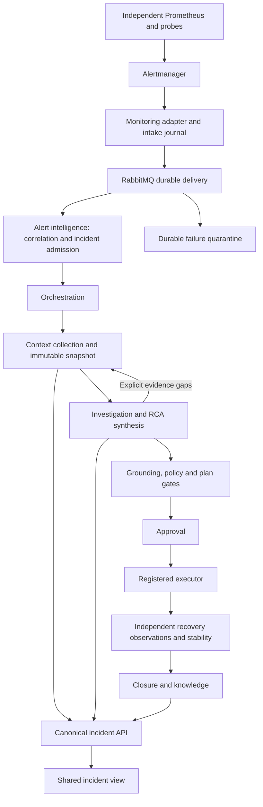

# KaiMS architecture and pipeline review - 12 September 2026

## Scope and system map

Reviewed deployed monitoring and queue state, application/project scoping, broker delivery and cancellation, immutable context/RCA persistence, evidence requirements, approval/execution contracts, independent recovery validation, canonical API/UI behavior, and repository quality gates. This is an evidence-based review of those boundaries, not certification of every cloud provider or every possible outage.

## Findings fixed in this review

| Boundary | Defect | Correction |
| --- | --- | --- |
| Broker publication | Unstarted real RabbitMQ, Kafka and Azure producers returned success without delivery. A caller could acknowledge or mark an outbox entry delivered. | Real producers now fail explicitly. Stopped Kafka publishers clear their handles. Explicit NoOp transport remains separate. |
| Broker intake | RabbitMQ acknowledged malformed JSON and wrong-shaped envelopes without durable retention. | Preserve original bytes in a persistent dead-letter envelope before acknowledgement; failed quarantine keeps the original message for redelivery. |
| Cancellation | Matching omitted nested alert/incident/context and canonical envelope identity fields. | Cancellation follows canonical subject IDs across stage envelopes, preserving existing top-level identities. |
| Snapshot concurrency | Final investigation snapshots used parent.version + 1 without verifying that the parent was still current. Retry covered recommendation commit but not snapshot creation. | Reject stale parents under the transaction; bounded refresh/retry covers the complete attempt in both broker and direct API entry points. Tenant and evidence-integrity errors are not retried. |
| Failure visibility | Snapshot supersession became generic handler_failed. | Publish a safe, actionable explanation directing reanalysis against current evidence. |
| Browser request isolation | Cached GET keys distinguished only authenticated/public; sessions could share responses. Caller cancellation was replaced by the query client's signal. | Opaque header-scope cache keys; caller-owned cancellation remains authoritative. Tokens are not placed in cache keys. |
| Browser mutation delivery | Shared request code retried POST by default and retried client errors through a catch block. TanStack could add another retry layer. | Mutations default to one attempt; no retries for authorization/validation/contract failures; one bounded read retry layer. Explicit opt-in retry remains possible. |
| Incident navigation | Timeline stage buttons switched to an obsolete empty details layout. | Route every selectable stage to the canonical incident workspace; remove unused embedded-detail calculations. |
| Application shell | Application visibility policy added to the oversized legacy shell. | Extract that policy to a named module; retain authoritative registry selection and migration budget. |
| Monitoring ownership | Aggregated platform alerts dropped job labels and had no explicit application/service scope. | Give platform SSE, dead-letter, workflow, database and model-fallback rules explicit KaiMS project/application/service/environment labels. |
| Quality gates | Full lint failed, cloud tests assumed an editable project field, and architecture checks equated network polling with fabricated progress. | Remove dead code, test the real selected-project scope, and check canonical schema/grounding boundaries without rejecting legitimate polling. |

Earlier synthesis-budget, evidence-gap preservation, context-refresh, and investigation-retry corrections are documented in context-pipeline-review-2026-09-12.md and remain included.

## Verification

- Full backend run: 1224 tests passed. Additional final focused broker and safe-failure tests: 17 passed.
- Full frontend quality gate: lint, architecture budget, TypeScript and 241 tests across 50 files passed.
- Production UI build and compressed asset budgets passed. Vite still reports the large legacy shell chunk; no budget was raised.
- Recovery topology tests: 2 passed.
- Prometheus validated all 67 alert rules after explicit ownership labels were added.
- Live target audit: central Prometheus has 55 targets, with only optional Online Boutique cAdvisor down; Telemetry Prometheus has one collector target and it is up.
- Actual recovery registry loader succeeds with 39 profiles and one source. A raw relative-path existence check would be misleading; the loader resolves the repository root.

### Final deployed verification

- All 25 reviewed service containers match the newly built image IDs, are running, and have zero restarts. All configured Docker health checks pass.
- All 24 HTTP services return 200 from both /healthz and /readyz. The Temporal worker has a process health check, not an HTTP listener.
- Live browser checks pass for saved Telemetry selection, explicit KaiMS selection after reload, and preference retention during registry failure and recovery.
- An isolated temporary RabbitMQ exchange verified rejection of unstarted publication, successful delivery after a transient handler failure, and exact malformed-byte quarantine. Its test queues and exchange were removed afterward.
- Both affected KaiMS and Telemetry operations-state endpoints return 200 with context, investigation, requirements and resolution fields. This is API availability proof, not proof that historical RCA results have been regenerated.
- Repeat deployment verification with `.venv/Scripts/python.exe scripts/verify_architecture_deployment.py`.

## Historical failure audit

Read-only inspection found 53 existing resolution dead letters affecting 10 incident identities. Thirty-five mentioned superseded snapshots and eleven timed out; categories can overlap with the broader snapshot category. Messages were returned to the same queue. They were not replayed into incident, ticket or remediation workflows. Existing historical failure records are not erased by a code deployment.

## Deployment and rollback

The complete backend and AI source package is layered on the existing local service runtime images, with repository and service-entrypoint import checks during every build. An initial sparse shared-module rollout exposed incompatible database imports in older base images; those services were rolled back before rebuilding the coherent source package. This makes source consistency a deployment requirement rather than assuming all local base images contain the same revision. The deployment manifest records exact file hashes, resulting image IDs, owning Compose services, and before-architecture-review-20260912 rollback tags. This avoids treating inherited release metadata as proof of the new workspace code. Monitoring remains in its independent Compose project.

## Boundaries still requiring operational work

- Monitoring and applications still share one Docker host. Detecting total host/engine loss requires an external watchdog or another host.
- Monitoring and recovery coverage are not universal. The registry has reviewed target-specific profiles, not proof of complete recovery coverage for every Telemetry microservice. Missing profiles/capabilities must not be replaced with guessed thresholds or automatic closure.
- The optional Online Boutique cAdvisor target does not resolve; its deployment or target scoping remains separate from the healthy KaiMS/Telemetry targets.
- Telemetry OpenSearch data is not backed by a persistent volume in the demo deployment. A storage migration must preserve existing evidence before replacing its data directory.
- Full authenticated browser-to-remediation-to-recovery execution was not run against live user incidents. Component/router tests, public-session browser checks, and an isolated broker exercise are distinct from that proof.
- The legacy React shell and shared repository remain large migration hotspots. This review fixes specific boundary defects; it does not claim a complete modular rewrite.
