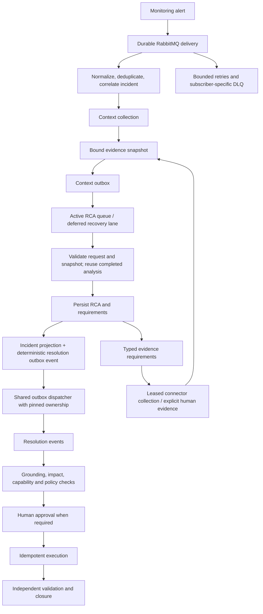

# MQ, context collection, and resolution redesign ? 2026-09-13

## Scope and operating model

RabbitMQ is the durable delivery mechanism; the database owns workflow state, evidence bindings, retries and committed handoffs. Delivery is at-least-once. An acknowledged message must represent either committed business progress or a recoverable durable handoff. It must never mean an unrecorded attempt, confirmed causality, approval, or recovery.

## Implemented changes

### Connection-safe outbox ownership

Three different services dispatched the same outbox using a MySQL advisory lock acquired through an ORM session. Their commits could return that physical connection to the pool while the advisory lock remained associated with it. A later release could run on a different connection. This threatens both mutual exclusion and progress.

The new `common.advisory_lock.advisory_connection` explicitly checks out one connection for the entire lock lifetime. It ends the acquisition transaction, pins subsequent ORM sessions to that connection, and releases on that same connection. Acquisition/release uncertainty invalidates the physical connection rather than returning uncertain ownership to the pool. Busy ownership does not release another worker's lock. Cancellation and business failures exit through lock cleanup.

`common.outbox_dispatch.flush_resolution_outbox` replaces the three duplicated context, closure and remediation implementations. It bounds publishing, commits each delivery result, and treats database failure separately from broker failure. A failed DB commit does not become a fake successful publication or an attempt to write retry state through an invalid transaction.

### Remediation ownership uses the same lifecycle

The target reservation and stale-work watchdog also acquired connection-scoped locks through sessions that committed before release. Both now use `advisory_session`, retaining the same physical connection through the transaction and release. Existing exclusive-target checks, durable action leases, approval checks and watchdog decisions are unchanged. SQLite development/test mode keeps its existing local serialization.

### Context collection runs once under ownership

The previous broad exception handler enclosed the connector call itself. Any connector exception was logged as a lease error and caused another collection attempt outside the distributed lock. Lock contention also fell through to collection. The new path returns a retryable HTTP 503 for an occupied lease, propagates lock errors, and propagates connector failure after exactly one attempt. In-process coalescing and the existing realtime strategy remain supported.

Leased enrichment batches retain the existing five concurrent jobs, 120-second job leases, 90-second collection timeout and bounded retry policy. Individual evidence requirements remain independently tracked; missing evidence is not converted into proof or an executable plan.

### Durable RCA-to-resolution handoff

Previously `_persist_resolution_event` committed incident progress but the downstream resolution event was published directly later. The committed RCA had no associated durable outbox handoff at this point. Reaching the next stage depended on successful direct publication or a later input replay.

The incident update and resolution outbox row now commit together. The event identity is deterministic over tenant, incident and recommendation ID. Replaying a recommendation repairs or reuses its handoff rather than generating another random event identity. New RCA versions retain distinct identities. Database-enabled workers no longer perform a second direct publication after committing this handoff. Database-disabled development mode retains direct publishing. A missing persistence session in database mode raises instead of silently losing the event.

The existing completed-analysis replay path, snapshot freshness checks, background coalescing, grounded-RCA checks, HITL and governed execution remain in effect.

## Validation

Final combined regression: **160 passed**, one unrelated logging-library deprecation warning. JUnit inventory: `mq-redesign-regression-2026-09-13.xml`. This combined run covers the final code; the grouped runs below document intermediate checks.

- 71 cases passed: connection ownership, context collection, context knowledge reuse, enrichment lifecycle and backlog behavior.
- 30 cases passed: governed resolution handoff, human assignment, RCA coalescing and analysis request lifecycle.
- 1 database integration case passed: no broker required to commit the resolution handoff; two replays retain one pending event; a different recommendation creates a second event; approval requirement preserved.
- Live MySQL read-only test passed: identical connection across commits, competing acquisition denied, release followed by successful reacquisition. The test used a unique named lock and SELECT statements only, and also verified the ORM-session helper. Reproduce with `scripts/verify_pipeline_ownership.py` in a configured service environment.
- Prior transport review: 60 regression cases and 42 isolated real-broker assertions. These remain separate from the new ownership/business-handoff tests.

Logs: mq-ownership-redesign-tests-2026-09-13.log, mq-resolution-redesign-tests-2026-09-13.log, mq-durable-resolution-test-2026-09-13.log, mq-live-lock-verification-2026-09-13.log.

## Rollout and practical limits

The new code changes context-agent, resolution-agent, closure-service and remediation-engine, plus shared ownership/dispatch modules. Their images are rebuilt without restarting services. The earlier 25-service transport rollout still requires explicit approval after automatic approval review rejected broad restart risk. The old readiness record is superseded. The deployment command now validates all recorded source hashes, not only the three transport files, before allowing prepared images to roll.

Roll all three outbox dispatchers together with resolution during the approved deployment window: existing processes using the old ownership code must not remain indefinitely mixed with the new implementation. Start/health-check services sequentially; retain production messages and DLQs. Verify the new context, resolution, approval and closure handoffs on the deployed stack after rollout.

This is a redesign of the critical ownership and persistence paths, not a claim that all real incidents now have confirmed RCA or impact. No real remediation was executed. Historical DLQ failures were not replayed. Exactly-once business execution still requires durable idempotency at side-effect boundaries; in-memory duplicate caches alone are insufficient. The global outbox lock still serializes dispatch; a future sharded leased-outbox scheduler should be justified by measured dispatch throughput, with ordering and takeover tests, rather than removing serialization without an ownership replacement.

## Approved deployment completed

The user explicitly approved the rollout. All 25 application services were rolled and verified against expected image IDs; all health/readiness endpoint checks passed. The deployed transport passed 42 isolated broker assertions across eight stages. The deployed MySQL connection/session ownership test passed without business writes. All 49 application queues have their expected subscriber-specific DLQ binding.

Live verification exposed an additional MySQL 1038 out-of-sort-memory failure: the outbox query sorted full rows containing large context payloads. The query now sorts only event IDs and fetches payloads separately, preserving due order. Sixteen targeted tests passed; a live read-only check loaded 100 records in 11.042 seconds without the sort failure. The three dispatcher services were rebuilt and rolled with this correction, then the full service verification passed again.

The outbox started with 637 due context events. At the final observation, 496 remained and published records had increased from 9,678 to 9,824. Processing is continuing; this is not a claim that every historical incident has resolved. The broker showed 63 ready and 4 unacknowledged active/recovery deliveries. All 144 historical RCA dead letters remain retained; none were purged or manually replayed.

Evidence: mq-final-service-verification-2026-09-13.json, mq-deployed-transport-tests-2026-09-13.log, mq-deployed-lock-verification-2026-09-13.log, mq-deployed-broker-summary-2026-09-13.json, mq-deployed-outbox-status-2026-09-13.json, mq-outbox-live-query-fix-2026-09-13.log.
